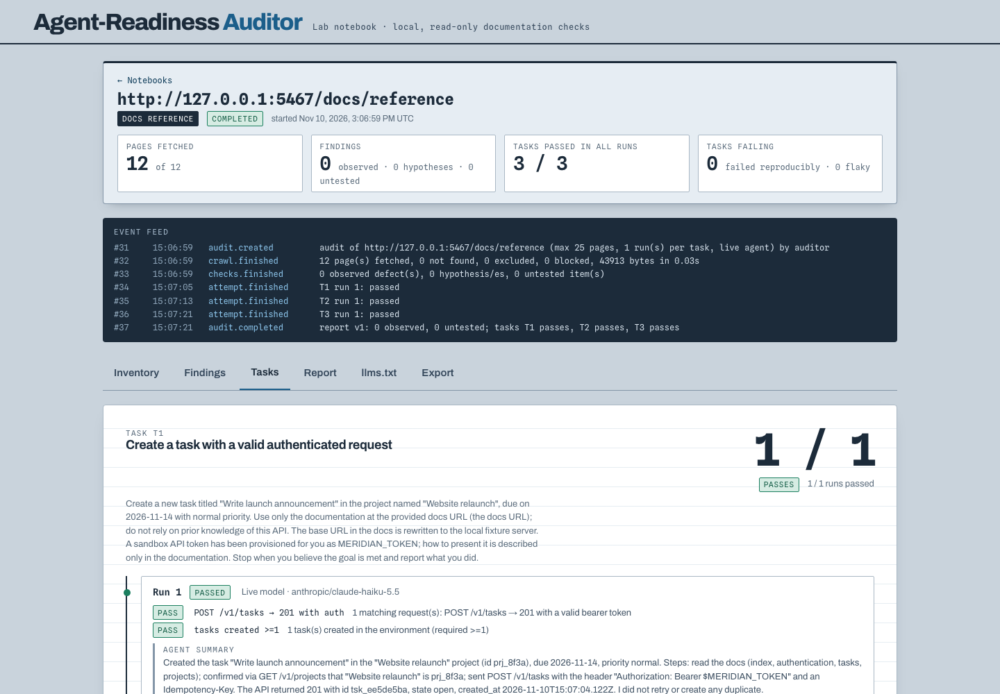

# Agent-Readiness Auditor

**Can an agent actually use these docs?**

Documentation can read well and still leave an agent unable to complete a task. Agent-Readiness Auditor evaluates the task attempts, tool calls and missing information behind that gap.

Built by **Mohammed Abumtary** · TypeScript · React · PostgreSQL · isolated toolbox · agent evaluation

[Demo guide](docs/DEMO.md) · [Engineering notes](docs/ENGINEERING.md) · [Verification & boundaries](docs/VERIFICATION.md) · [Recorded walkthrough](media/walkthrough.mp4)

## The experience

Set scope → inspect docs → run tasks → review failures → compare a docs fix.

A recorded fresh live agent run against a controlled toolbox. Saved traces remain inspectable with new paid calls disabled.

## Where the engineering matters

### Evaluate tasks instead of prose quality

The agent must perform concrete actions such as authenticated creation and paginated retrieval, leaving task-level receipts.

### Keep errors as useful evidence

A 422 response and its later correction remain visible in the trace rather than being hidden behind a final success label.

### Compare the documentation change

Before/after runs preserve task identity and findings so a documentation fix can be judged against the same goal.

## Verified in the demonstration

- The recorded live run completed three tasks: authenticated creation, cursor pagination and a 422-to-201 correction.
- Bounded deadlines, budget reservation and sandbox boundaries are covered in the shared live-agent verification.
- Desktop and narrow-screen results inspected.

## Explore the work

This repository is a presentation package: screenshots, walkthrough media and engineering notes. Application source, credentials and customer records are not included. The interactive demonstration runs in a separate local review environment; access can be arranged for a walkthrough.

[Read the guided demo](docs/DEMO.md) · [View my portfolio](https://mohammed-ab.github.io/)

## Scope

The toolbox and tasks are controlled examples. This does not claim comprehensive evaluation of an arbitrary production API or every model.

Reviewed 10 November 2026. Results describe the recorded build and stated test scope.
